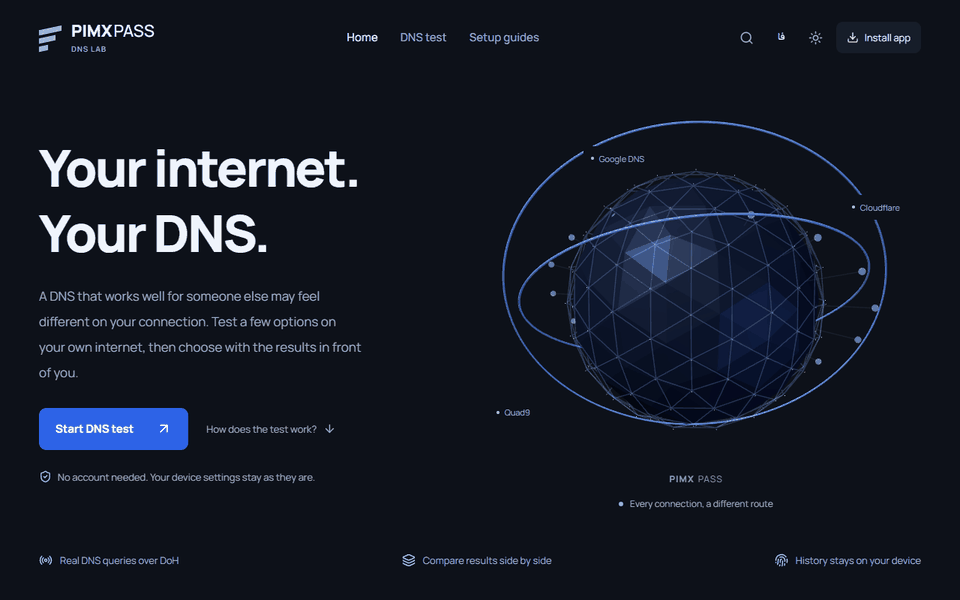

<div align="center">

<a href="https://pimxpassdns.pages.dev/"></a>

[English](README.md) · [فارسی](README.fa.md) · [Live website ↗](https://pimxpassdns.pages.dev/)

[](https://github.com/MOHAMMADREZAABEDINPOOR/PIMX_PASS_DNS)

</div>

# PIMX PASS DNS

سرویس‌های DNS را روی اینترنت خودت با درخواست واقعی DNS-over-HTTPS مقایسه کن؛ با شبکهٔ سه‌بعدی زنده، مقایسه‌های ذخیره‌شده و راهنمای تنظیم دستگاه. تاریخچهٔ هر شبکه را نگه دار، DNS دلخواه اضافه کن و از نتایج خروجی بگیر.

<a href="https://pimxpassdns.pages.dev/"></a>

[پیش‌نمایش رابط بازطراحی‌شده · PNG](assets/readme/redesign.png) · [Static artwork](assets/readme/hero.png)

## امکانات

- اندازه‌گیری واقعی DoH، مقایسهٔ DNSها و شبکهٔ سه‌بعدی زنده
- تاریخچهٔ محلی، علاقه‌مندی‌ها، ورود DNS دلخواه و خروجی JSON/CSV/TXT/PNG/QR
- صفحه‌های خانه، آزمایش و راهنما؛ فارسی و انگلیسی، دو پوسته و PWA آفلاین

## از مقایسه تا تنظیم دستگاه

۱. معرفی را در `/` بخوان و از آنجا وارد آزمایشگاه `/test/` شو.
۲. منبع DNS را انتخاب کن یا فهرست خودت را وارد کن؛ آزمایش را اجرا کن و نتایج اندازه‌گیری‌شده را مقایسه کن.
۳. مجموعه را ذخیره کن یا خروجی بگیر و برای تنظیم دستگاه به `/guide/` برو. مسیرهای انگلیسی `/en/`، `/en/test/` و `/en/guide/` هستند.

رابط آبی کبالت و گرافیتی، پوستهٔ روشن و تاریک، فهرست‌های جست‌وجوپذیر قابل استفاده با کیبورد و پشتیبانی از کاهش حرکت دارد. تاریخچه، تنظیمات و مجموعه‌ها در همین مرورگر نگه داشته می‌شوند.

## معنی اندازه‌گیری‌ها

آزمایش DoH درخواست واقعی DNS-over-HTTPS می‌فرستد. دسترسی HTTPS جداگانه مشخص می‌شود؛ مرورگر نمی‌تواند DNS خام UDP یا همهٔ پروتکل‌های رمزگذاری‌شده را آزمایش کند. نتیجه به اینترنت شما، پشتیبانی مقصد و CORS وابسته است. برنامه تنظیم DNS سیستم را تغییر نمی‌دهد و کاهش پینگ بازی را تضمین نمی‌کند.

پایش زمان‌بندی‌شده به Worker جداگانهٔ Cloudflare و اتصال مشترک `MONITOR_KV` نیاز دارد. مسیر شبکهٔ این پایش با اتصال مرورگر شما متفاوت است و ساخت فرانت‌اند به‌تنهایی آن را فعال نمی‌کند.

## اجرای محلی

Node.js نسخهٔ 22.12 یا جدیدتر لازم است.

```sh
npm ci
npm run dev
```

| فرمان | کاربرد |
| --- | --- |
| `npm run lint` | بررسی TypeScript |
| `npm run build` | ساخت نسخهٔ نهایی و شش صفحهٔ محلی‌سازی‌شده |
| `npm run preview` | پیش‌نمایش نسخهٔ نهایی |
| `npm test` | آزمون‌های مرورگر و اندازه‌گیری با Playwright |
| `npm run deploy` | ساخت و انتشار فرانت‌اند Pages |
| `npm run deploy:monitor` | انتشار Worker پایش با تنظیمات مستقل |

## استقرار و کد

پوشهٔ `dist` را همراه `functions/` روی Cloudflare Pages منتشر کنید. نصب و پیمایش آفلاین به ساخت نهایی و HTTPS نیاز دارد. API اختیاری آمار تنظیمات استقرار خودش را دارد.

[راهنمای استقرار](DEPLOYMENT.md) · [راهنمای آزمایشگاه](LAB_GUIDE.fa.md) · [سرویس‌های اندازه‌گیری](services/) · [کد پایش](cloudflare/)

[GitHub](https://github.com/MOHAMMADREZAABEDINPOOR/PIMX_PASS_DNS) · [PIMX](https://github.com/MOHAMMADREZAABEDINPOOR) · [Portfolio](https://pimx.pages.dev/)
