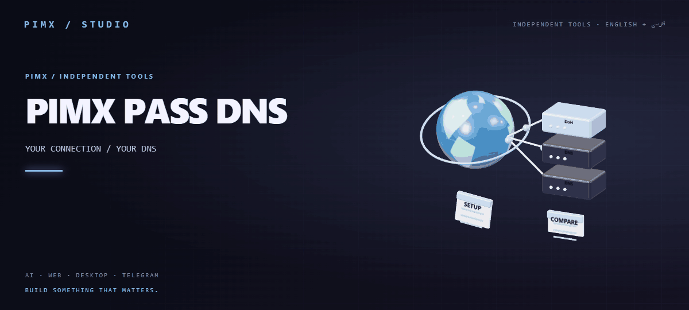

<div align="center">

<a href="https://pimxpassdns.pages.dev/"></a>

[English](README.md) · [فارسی](README.fa.md) · [Live website ↗](https://pimxpassdns.pages.dev/)

[](https://github.com/MOHAMMADREZAABEDINPOOR/PIMX_PASS_DNS)

</div>

# PIMX PASS DNS

Compare DNS resolvers on your own connection with real DNS-over-HTTPS queries, a live 3D network, saved comparisons and device setup guides. Keep network-specific history, import custom resolvers and export results.

## What you can do

- Real DoH measurements, resolver comparisons and a live 3D network
- Local history, favorites, custom imports and JSON/CSV/TXT/PNG/QR exports
- Separate Home, Test and Guide pages; Persian/English, themes and offline PWA

## From comparison to setup

1. Read the introduction at `/en/`, then open `/en/test/`.
2. Choose a resolver source or import your own, run a test and compare the measured results.
3. Save a collection or export results, then open `/en/guide/` for device-specific setup. Persian routes are `/`, `/test/` and `/guide/`.

The cobalt and graphite interface includes light/dark themes, searchable keyboard-operated selectors and reduced-motion support. History, preferences and saved collections are local to this browser.

## What the measurements mean

DoH tests issue actual DNS-over-HTTPS queries. HTTPS reachability is labeled separately; a browser cannot benchmark raw UDP DNS or every encrypted DNS protocol. Results depend on your connection, endpoint support and CORS. The app does not change system DNS or guarantee lower game latency.

Scheduled service health uses a separate Cloudflare monitoring Worker and shared `MONITOR_KV` binding. Edge monitoring measures a different network path from your browser; building the frontend alone does not enable scheduled checks.

## Run locally

Use Node.js 22.12 or newer.

```sh
npm ci
npm run dev
```

| Command | Purpose |
| --- | --- |
| `npm run lint` | TypeScript checks |
| `npm run build` | Production build and six localized static entry pages |
| `npm run preview` | Preview production output |
| `npm test` | Playwright browser and measurement checks |
| `npm run deploy` | Build and deploy the Pages frontend |
| `npm run deploy:monitor` | Deploy the separately configured monitoring Worker |

## Deployment and source

Deploy `dist` to Cloudflare Pages with the included `functions/`. Install and offline navigation require a production build over HTTPS. The optional analytics API uses its own deployment configuration.

See [deployment](DEPLOYMENT.md), [the laboratory guide](LAB_GUIDE.fa.md), [measurement services](services/) and [monitoring source](cloudflare/).

[GitHub](https://github.com/MOHAMMADREZAABEDINPOOR/PIMX_PASS_DNS) · [PIMX](https://github.com/MOHAMMADREZAABEDINPOOR) · [Portfolio](https://pimx.pages.dev/)
